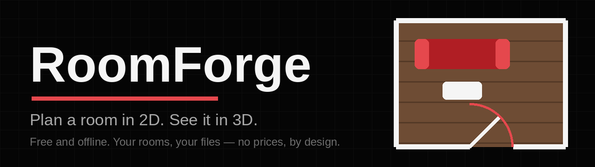
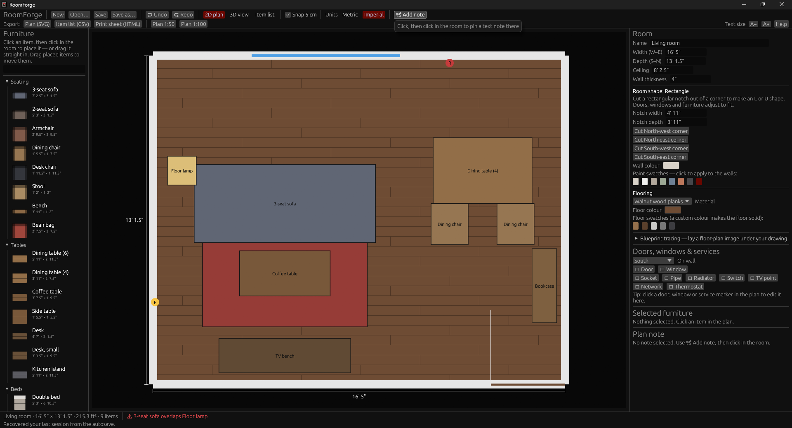
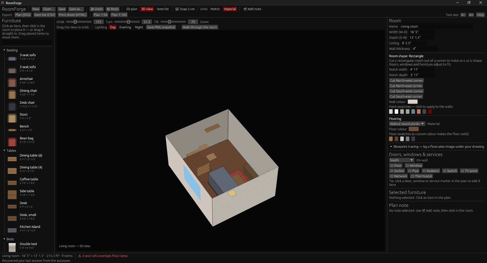
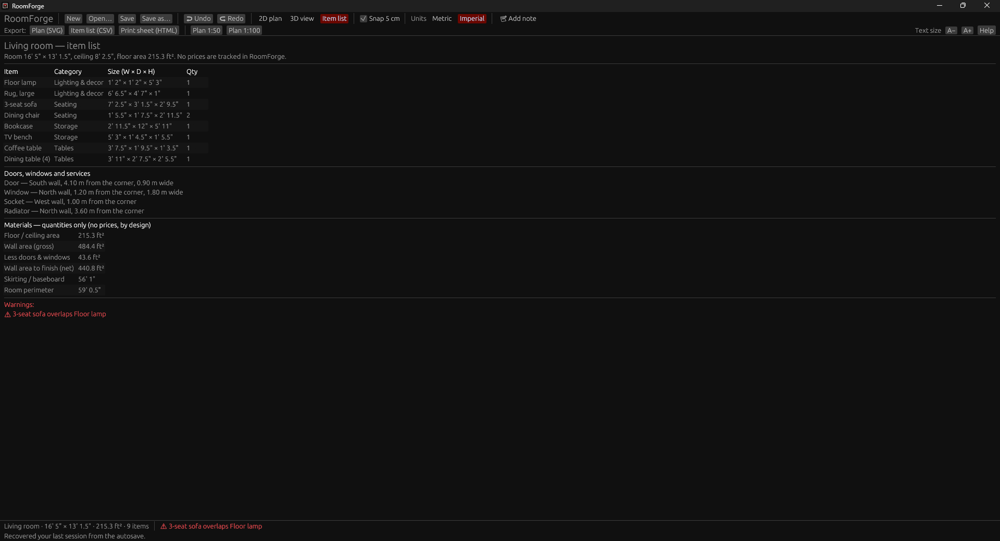
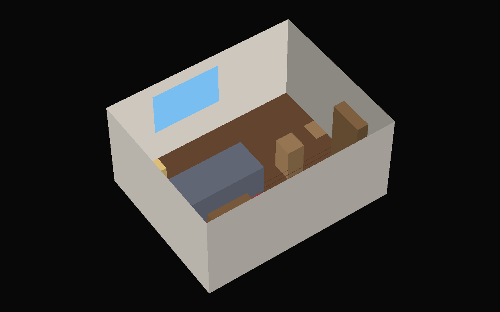

# RoomForge

**Plan a room on your Windows PC before you move a single piece of real furniture.** Draw the room to its true size, mark the doors, windows, sockets and pipes, drag furniture around in 2D, check it in 3D, then print the plan and the item list. Fully offline. No prices, anywhere — by design.

## TL;DR

Think of RoomForge as graph paper that knows how big your sofa is. You tell it how big your room is, draw in the bits that can't move — doors, windows, radiators, plug sockets — then drag pictures of furniture around until everything fits nicely. You can peek at the room in 3D, like looking into a doll's house, and print the finished plan to take shopping or hand to a helper. It never needs the internet, and it never shows prices, because it's for planning where things go, not for buying them.

## Contents

- [Key features](#key-features)
- [Screenshots](#screenshots)
- [System requirements](#system-requirements)
- [Installation](#installation)
- [How to use RoomForge](#how-to-use-roomforge)
- [Settings, shortcuts and file formats](#settings-shortcuts-and-file-formats)
- [Building from source](#building-from-source)
- [Project structure](#project-structure)
- [Tests](#tests)
- [Troubleshooting](#troubleshooting)
- [Privacy and your data](#privacy-and-your-data)
- [Limitations and known issues](#limitations-and-known-issues)
- [Roadmap](#roadmap)
- [Contributing](#contributing)
- [License and credits](#license-and-credits)

## Key features

### Draw the room to scale

- Set the room's real **width, depth and ceiling height**, plus its **wall thickness** (drawn to scale on the plan; room sizes stay clear internal dimensions).
- **Not just rectangles**: cut a notch out of any corner to make an **L-shaped** room (or a U/C shape with more notches) — floor area, materials, furniture placement and the walls in 2D, 3D and exports all follow the real outline. Restore the plain rectangle whenever you like.
- **Dimension lines** with real measurements sit on the plan while you work.
- Type sizes in **metric or imperial** — `5 m`, `500 cm`, `2500 mm`, `10' 6"`, `126"` all work — and flip the whole app between the two with the Units toggle.

### Add the things that can't move

- **Doors** (with swing direction) and **windows** (with sill height), placed on any wall.
- **Seven kinds of wall service points**, each with its own plan symbol: electrical socket, pipe/water, radiator, light switch, TV point, network point, thermostat.
- **Warnings that catch real mistakes**: furniture overlapping other furniture, furniture covering a radiator or pipe, and furniture standing in a door's swing path.

### Furnish it in 2D

- A built-in catalog of **49 generic pieces** in 8 groups (Seating, Tables, Beds, Storage, Kitchen, Bathroom, Lighting & decor, Other), each with real-world dimensions. The catalog shows each piece as a little top-down drawing of itself. Search it, then click a piece and click in the room to place it — or **drag the piece straight in**. Hold **Shift** to place several.
- **Build your own pieces**: the catalog panel's "Your items" section lets you define furniture with your own name and exact size — an aquarium stand, a dog crate, that odd-shaped desk — and place it like any catalog piece. Your definitions are saved inside the plan file.
- **Templates**: the New menu offers furnished Living room, Bedroom and Home office starting points, plus an empty room.
- Drag to move, rotate in 15° steps (**R**) or 90° steps (**Shift+R**), resize, recolour, duplicate and delete. Optional **5 cm snapping** while dragging — plus **magnetic alignment**: pieces snap to each other's edges and centres and to the room's centre lines, with red guide lines and a live readout of the gap to each wall while you drag.
- **Undo and redo** (100 steps) for everything, and an **autosave every few seconds** — if the program closes unexpectedly, your last session is recovered on the next start.

### Trace over a real plan

- Load a scanned or photographed floor plan (PNG, JPEG or BMP, up to 12 MB) and it appears **under your drawing**, fitted to the room.
- **Calibrate it to true scale**: click two points whose real distance you know (a doorway works well), type the distance, and the image rescales to match. Adjust its opacity while you trace.
- The image is stored **inside the plan file**, so a plan you share keeps its underlay.

### See it in 3D, take it with you

- **Multi-room plans**: a plan can hold a whole home. The Rooms strip switches between rooms; each keeps its own size, flooring, walls and furniture, doors can be labelled with the room they lead to, and the item list and print sheet cover every room with whole-home totals.
- One click switches to a **3D doll's-house view** of the same room: drag to orbit, with sliders for turn and tilt. Skirting boards and soft shadows under the furniture make it read as a real room, and **New → Template gallery** offers the starter rooms as picture cards.
- The **Item list view** shows everything placed, grouped and counted, with sizes — and the doors/windows/services schedule and any warnings.
- A **materials list with quantities only**: floor and ceiling area, wall area before and after subtracting doors and windows, skirting length and perimeter — enough to buy paint and flooring by. (Quantities, never costs: see the no-prices rule below.)
- Pin **text notes** to the plan (numbered markers); they appear in the list view and in exports.
- **Exports**: a to-scale plan (SVG), true-scale print plans at **1:50** and **1:100** (print at 100% and they measure exactly), the item list (CSV), and a printable plan + list sheet (HTML — open in a browser, print or save as PDF).

## Screenshots

All screenshots are real runs of RoomForge v0.6.0 on Windows — never placeholders or stock images. The capture list is in [docs/screenshots/CAPTURE.md](docs/screenshots/CAPTURE.md).

**The 2D plan** — walnut plank flooring, furniture placed, the room panel showing shape, flooring and paint controls:



**The 3D view** of the same room:



**The item list** — everything placed, the doors/windows/services schedule, and the quantities-only materials list:



**A PNG snapshot** — this picture was rendered by RoomForge itself (3D view → "Save PNG snapshot"), not captured from the screen:



## System requirements

| | |
| --- | --- |
| Operating system | Windows 10 or Windows 11 (64-bit) — the program is designed and CI-tested for Windows; it also compiles on Linux for development |
| Display | 1280 × 820 window by default (minimum 900 × 600); the 3D view uses OpenGL through your normal graphics driver |
| Disk | A few MB for the program; plan files are small (larger if you embed a tracing image) |
| Internet | **Not required** — not for installing from source, designing, saving, rendering or reopening projects |
| To build | Rust 1.80 or newer (see [Building from source](#building-from-source)) |

Anything more specific (minimum RAM, GPU models) is **to be confirmed** — it hasn't been benchmarked yet, and the app is deliberately lightweight.

## Installation

**Easiest — download the release.** On the [Releases page](https://github.com/SeanShaffer88/RoomForge/releases), download `RoomForge-v1.1.0-windows-x64.zip` (or the standalone `roomforge.exe`), unzip it anywhere, and run `roomforge.exe`. No administrator rights, no installer. The executable is not code-signed yet, so Windows SmartScreen may warn on first run — choose **More info → Run anyway**. `SHA256SUMS.txt` on the release page lets you verify the download.

**Or build from source** (a couple of minutes):

1. Install Rust from [rustup.rs](https://rustup.rs) if you don't have it.
2. Download or clone this repository.
3. In the repository folder, run:

```sh
cargo run --release
```

The built program is at `target\release\roomforge.exe`. Either way, you can open a plan directly:

```sh
roomforge path\to\my-room.roomforge
```

## How to use RoomForge

1. **Start.** RoomForge opens with a starter living room so you can experiment, or click **New** for an empty room. If a previous session ended unexpectedly, the autosave is recovered automatically and the status bar tells you.
2. **Size the room.** In the right-hand **Room** panel, type the real width, depth, ceiling height and wall thickness (either unit system), and pick wall/floor colours. Choose a **flooring material** — oak or walnut planks, tiles, carpet, polished concrete — and its pattern appears in every view and export. Paint swatches give one-click wall colours.
3. **Add doors, windows and services.** Still in the right panel: choose a wall, then add doors and windows; use the ＋ buttons for sockets, pipes, radiators, switches, TV/network points and thermostats. Click any of them on the plan to adjust its position and size, or delete it.
4. **(Optional) Trace a plan.** Room panel → **Load plan image…**, then **Calibrate scale** and click two points a known distance apart. Trace walls by sizing the room and placing fittings over the image.
5. **Furnish.** In the left catalog, search or browse, click a piece then click in the room to drop it — or drag pieces straight in from the list. Drag placed pieces to move them (they align magnetically, with guide lines and live wall gaps); use the right panel to fine-tune size, position, rotation and colour. Watch the bottom bar — it calls out overlaps and blocked doors as you work.
6. **Annotate.** **📝 Add note**, click in the room, and type. Click a note's marker to edit or delete it.
7. **Check it in 3D.** Press **2** (or click **3D view**), drag to orbit. Try the **Lighting** buttons — Day, Evening and Night change the mood of the room (and of snapshots). Then **Walk through the room** steps inside it: W A S D (or the arrow keys) move you, Q/E or dragging turns your head, Shift hurries, Esc steps back out — with proper collisions, so you get a real feel for the space between the furniture. **Save PNG snapshot** renders the 3D view to a picture file you can send to anyone — no screenshot needed, and the walk has its own **Save PNG of this view** for a picture from where you're standing. Press **3** for the item list.
8. **Save and share.** **Ctrl+S** saves a `.roomforge` file — send that file to anyone; it opens in their copy, tracing image included.
9. **Print and export.** Use the Export row: **Plan (SVG)** for a to-scale drawing, **Plan 1:50 / 1:100** for exact-scale printing, **Item list (CSV)** for a spreadsheet, **Print sheet (HTML)** for a tidy printable page.

## Settings, shortcuts and file formats

**In-app settings** (top bar and Room panel): Units (Metric/Imperial), Snap 5 cm on/off, tracing-image opacity, wall/floor colours, and text size (**A− / A+** at the right of the Export row — everything in the window scales, for tired eyes or small screens). RoomForge has no settings file and no accounts — everything else lives inside each plan file.

**Help, built in.** Press **F1** or click **Help** (right of the Export row) for a plain-language guide: the four steps to your first room, what the jargon words mean, every shortcut, and the things worth knowing (offline, autosave, no prices by design). Selecting a piece of furniture also shows the **space around it** — the gap to each wall — in the right-hand panel.

**Keyboard shortcuts**

| Keys | Action |
| --- | --- |
| `F1` | Open the built-in Help guide |
| `1` / `2` / `3` | 2D plan / 3D view / Item list |
| Arrow keys | Nudge the selected item (5 cm; **Shift** = 25 cm) |
| `R` / `Shift+R` | Rotate the selected item by 15° / 90° |
| `Delete` / `Backspace` | Delete the selected item or note |
| `Escape` | Cancel placing / calibration, clear selection |
| `Ctrl+Z` / `Ctrl+Y` | Undo / Redo |
| `Ctrl+S` | Save |
| `Shift` while placing | Keep placing more of the same piece or note |

**File formats**

| Format | What it is |
| --- | --- |
| `.roomforge` | A plan file: versioned, human-readable JSON (format version 2; version 1 files still open). Written safely — a temporary file is swapped into place, so an interrupted save shouldn't corrupt an existing plan. Files from a newer RoomForge version are refused with a clear message rather than misread. |
| `.svg` (export) | To-scale plan drawing; the 1:50 and 1:100 variants carry physical sizes for exact printing. |
| `.csv` (export) | The grouped item list: item, category, size, quantity. |
| `.html` (export) | Self-contained printable sheet: plan, item list, fittings schedule and notes. |
| PNG / JPEG / BMP (import) | Tracing underlay images, embedded into the plan file (base64). |

## Building from source

Prerequisites: a stable Rust toolchain, version **1.80 or newer** (the project's `rust-version`), and — on Windows — the usual MSVC build tools that `rustup` offers to install.

```sh
cargo build --release          # build → target\release\roomforge.exe
cargo run --release            # build and run
cargo test --locked            # run the test suite
cargo clippy --all-targets --locked -- -D warnings   # lint gate (must be clean)
cargo fmt --all --check        # formatting gate
```

Continuous integration (GitHub Actions, Windows runner) runs the format check, clippy, the full test suite and a release build on every push.

## Project structure

| Path | What lives there |
| --- | --- |
| `src/main.rs` | Program entry point: window setup, renderer choice, crash logging, opening a plan passed on the command line |
| `src/app.rs` | The desktop GUI (2D plan, 3D view, item list, panels) — renders state and collects input only |
| `src/model.rs` | The plan data model: room, openings, services, furniture, notes, tracing underlay, warnings |
| `src/catalog.rs` | The built-in furniture catalog (original, generic items) |
| `src/geometry.rs` | 2D geometry: overlap tests (including door-swing areas), snapping |
| `src/view3d.rs` | The 3D projection maths behind the 3D view |
| `src/render.rs` | The offline software renderer behind PNG snapshots of the 3D view |
| `src/export.rs` | SVG plan (incl. true-scale variants), CSV list, printable HTML |
| `src/units.rs` | Metric/imperial formatting and parsing of typed lengths |
| `src/io.rs` | Saving/loading plans, atomic writes, the autosave location |
| `docs/PRODUCT_AND_ENGINEERING_PLAN.md` | The full product and engineering plan, with the resource research behind it |
| `docs/FEATURE_ADOPTION.md` | Which features from existing tools were adopted, scheduled, or deliberately not adopted — and why |
| `docs/screenshots/CAPTURE.md` | The screenshot capture list |
| `DECISIONS.md` | Recorded design/scope decisions and their reasoning |
| `CHANGELOG.md` | What changed in each version |

## Tests

56 automated tests cover the library: the data model and file-format round-trips (including files saved by older versions), geometry and door-swing warnings, room outlines and notch cutting, the catalog, unit parsing/formatting, exports, underlay calibration maths, custom-item definitions, the materials quantities, flooring patterns, and the PNG snapshot renderer. Run them with:

```sh
cargo test --locked
```

The GUI itself is verified by running it — see the screenshot list for the on-machine checks that accompany a release.

## Troubleshooting

| Problem | What to do |
| --- | --- |
| The program closed and I hadn't saved | Reopen RoomForge — it autosaves every few seconds while you work and recovers the last session automatically (the status bar says so when it does). The autosave lives at `%LOCALAPPDATA%\RoomForge\autosave.roomforge`. |
| "This plan was saved by a newer version of RoomForge" | The file's format is newer than your copy understands. Update RoomForge; the file itself is untouched. |
| My tracing image won't load | It must be PNG, JPEG or BMP, and 12 MB or smaller. The status bar explains which limit was hit. |
| The tracing image is the wrong size | Use **Calibrate scale** in the Room panel: click two points a known distance apart (a doorway is ideal) and type the real distance. |
| The plan prints at the wrong size | Use the **Plan 1:50** or **Plan 1:100** export and print at exactly 100% (no "fit to page"). |
| Something crashed | Check `%LOCALAPPDATA%\RoomForge\roomforge.log` — errors are recorded there, and including it in a bug report helps a lot. |

## Privacy and your data

RoomForge works **fully offline**: no accounts, no sign-in, no telemetry, no analytics, and no network calls in the core program — designing, saving, rendering and reopening projects never need the internet. Your plans are files on your own computer, stored where you save them. The only things RoomForge writes on its own are in `%LOCALAPPDATA%\RoomForge\`: the autosave (`autosave.roomforge`) and the error log (`roomforge.log`).

There are **no prices anywhere in RoomForge** — no item prices, no totals, and none in exports. That's a deliberate design decision: RoomForge plans layouts; it isn't a shop.

## Limitations and known issues

- **One room per plan, rectilinear shapes only.** Corner notches give L/U/C shapes, but angled walls, free-form wall drawing, openings on notch edges, and multi-room/multi-floor plans are not built yet (multi-room is designed in the plan document).
- **Exports are metric**, even when the app is displaying imperial (the app itself is fully dual-unit).
- **No multi-page print tiling yet** — a big room at 1:50 may need a large sheet or a print shop; 1:100 fits most rooms on A4/Letter.
- **No installer wizard and no code signing yet** — the release is a portable zip/exe, and SmartScreen will warn on first run until signing is arranged.
- The tracing underlay is **aligned, not rotated**: it assumes your scan/photo is roughly square to the room; calibration fixes scale, not skew.
- Furniture is drawn as simple coloured shapes/boxes — this is a planning tool, not a photorealistic renderer (offline rendered views are on the roadmap).
- **Lighting scenes are moods, not real lighting**: Day/Evening/Night change the whole scene's brightness, tint and window colour at once; there are no individual lamps, shadows or light switches yet.

## Roadmap

Documented in [docs/FEATURE_ADOPTION.md](docs/FEATURE_ADOPTION.md) and [docs/PRODUCT_AND_ENGINEERING_PLAN.md](docs/PRODUCT_AND_ENGINEERING_PLAN.md). Already delivered from that list: L-shaped rooms (corner notches, format v2), the custom-object builder, the quantities-only materials list, procedural flooring materials, and offline PNG snapshots of the 3D view. Already delivered from that list also includes lighting scenes (Day / Evening / Night) for the 3D view and snapshots, and a first-person walkthrough. Already delivered also includes multi-room plans (a plan can hold a whole home, with per-room design and whole-home lists). Still ahead: import of GLB/OBJ models → user image textures. Printed page tiling is scheduled with the print work. Features deliberately **not** planned: prices or cost estimators, product configurators, photo/LiDAR room scanning, and anything that needs an account or the cloud.

## Contributing

Bug reports and suggestions are welcome as [GitHub issues](https://github.com/SeanShaffer88/RoomForge/issues) — the error log at `%LOCALAPPDATA%\RoomForge\roomforge.log` is gold for bug reports. Pull requests are welcome too; please run the format check, clippy and the test suite (commands above) before submitting, and keep the house rules in [AGENTS.md](AGENTS.md) — in particular: no prices, ever, and screenshots only from real runs.

## License and credits

RoomForge is open source under the **MIT License** — see [LICENSE](LICENSE). Created by Sean Shaffer. Built with Rust and the [egui](https://github.com/emilk/egui) immediate-mode GUI library (MIT/Apache-2.0); the furniture catalog is original and generic — no manufacturer's products, names or models are included.
